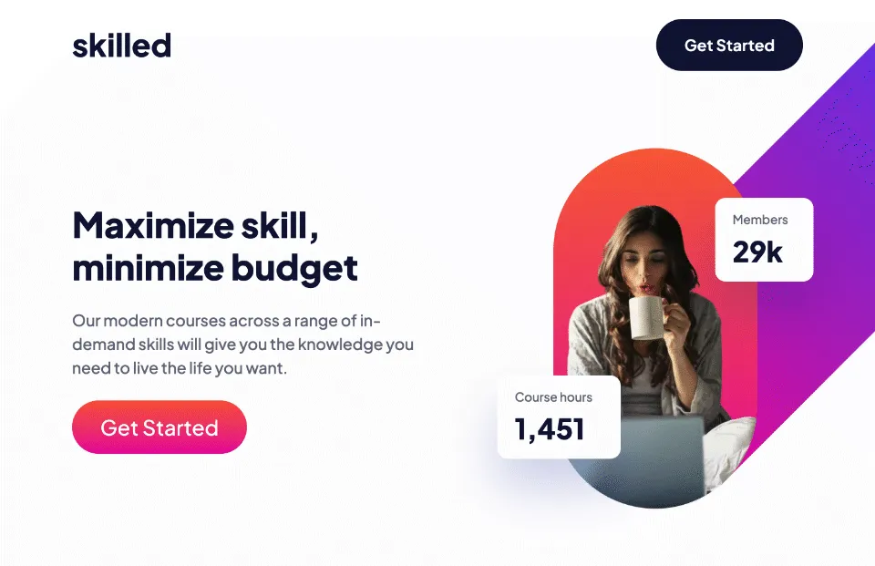

# Frontend Mentor - Skilled e-learning landing page solution

This is a solution to the [Skilled e-learning landing page challenge on Frontend Mentor](https://www.frontendmentor.io/challenges/skilled-elearning-landing-page-S1ObDrZ8q). Frontend Mentor challenges help you improve your coding skills by building realistic projects.

## Table of contents

- [Overview](#overview)
  - [The challenge](#the-challenge)
  - [Screenshot](#screenshot)
  - [Links](#links)
- [My process](#my-process)
  - [Built with](#built-with)
  - [What I learned](#what-i-learned)
  - [Continued development](#continued-development)
  - [Useful resources](#useful-resources)
  - [AI Collaboration](#ai-collaboration)
- [Author](#author)

## Overview

### The challenge

Users should be able to:

- View the optimal layout depending on their device's screen size
- See hover states for interactive elements
- Use a keyboard to access interactive elements

I should be able to:

- Keep it [DRY](https://en.wikipedia.org/wiki/Don%27t_repeat_yourself) by using a simple static site generator
- Use GitHub Actions to deploy the site to GitHub Pages

### Screenshot

### Links

- Live: <https://logicalplum.github.io/fm-skilled-elearning-landing-page>
- Code: <https://github.com/logicalplum/fm-skilled-elearning-landing-page>

## My process

- HTML:
  - Build with [Eleventy](https://www.11ty.dev/) to avoid duplicating HTML structures for each course thumbnail.
  - Eleventy default liquid templating with `html` extension for the page markup and `liquid` extension for partials
  - No build tooling other than Eleventy
- CSS:
  - Reset with [tailwindcss-preflight](https://github.com/grievouz/tailwindcss-preflight)
  - Check [caniuse.com](https://caniuse.com/) for broad support
- Fonts:
  - Self-hosted Google font
  - Convert to `woff2` format using [Google woff2](https://github.com/google/woff2) tooling
- Images:
  - Export hero image `png` files from Figma
  - Convert to `webp` using [Google webp package](https://developers.google.com/speed/webp/)
- Dev process:
    1. Draft HTML structure
    2. Dev CSS for mobile, then tablet, then desktop, revising HTML as needed
    3. Adjust breakpoints based on design behavior
    4. Check and correct accessibility issues
    5. Test and debug deployment process
    6. Write README

### Built with

- Semantic HTML5 markup
- CSS custom properties
- Flexbox
- CSS Grid
- Mobile-first workflow
- Art directed images
- [Eleventy](https://www.11ty.dev/)
- [GitHub Actions](https://docs.github.com/en/actions)

### What I learned

- **How to set up Eleventy for a simple case.** While build system _can_ help make a complex design easier, every moving part creates a complexity that needs to be properly set up, versioned, and debugged. Though, I had used Eleventy and other build systems previously, the setup for a blog or portfolio website is overkill here, and simple examples are hard to find. With the help of Claude Code, I was able to strip the build down to Eleventy's bare essentials.
- **How and when to use the `<picture>` element.** This challenge needed a different hero image at different screen widths, and that required use of the `<picture>` element with a `<source>` for each media query. Though `webp` is smaller than `png` or `jpeg`, it doesn't yet have universal browser support, so a `<source>` for `webp` and another for a fallback provides whichever works.
- **What to do with a decoration that overflows the screen.** Though challenge downloads included hero image assets in both `png` and `webp` formats for mobile, tablet, and desktop screens, the tablet and desktop images included a decoration that needed to overflow the screen. The images _can_ be relatively positioned to match the Figma designs for desktop, tablet, and mobile, but those are just three points on the wide spectrum of screen width possibilities. Getting that to work well across them all is tricky. Too tricky. I chose to go back to the Figma file and export just the core hero image without the decoration or the text overlays. I then positioned those with CSS grid and position the text overlays and decoration, added separately in the HTML, relative to the core image.
- **Colors needed to be adjusted to meet WCAG contrast requirements.** The solution deviated from the design to meet [WCAG contrast accessibility criteria](https://www.w3.org/WAI/WCAG22/quickref/#contrast-minimum):
  - Color of "Get Started" button in course thumbnails
  - Color of body text in course thumbnails
  - Size of "Get Started" button in hero section increased to satisfy criteria for large text
- **Responsive design breakpoints don't need to match Figma design sizes.** Setting the desktop and mobile media query breakpoints lower than the Figma design sizes can provide a better result across the variety of screen sizes.
- **How to deploy to GitHub pages using GitHub Actions.** Again, with some help from Claude.

### Useful resources

- [Self-hosting web fonts | Google Fonts](https://fonts.google.com/knowledge/using_type/self_hosting_web_fonts)
- [woff2 | GitHub](https://github.com/google/woff2)
- [woff2 | Homebrew Formulae](https://formulae.brew.sh/formula/woff2#default)
- [Colour Contrast Analyzer (CCA) | Vispero](https://vispero.com/lp/color-contrast-checker/)
- [WebP | Google for Developers](https://developers.google.com/speed/webp/)

### AI Collaboration

Claude Code was used to:

- Advise on simplifying Eleventy build
- Debug issues with GitHub Actions workflow for deployment to GitHub Pages

## Author

- Website - [John F MacDonald](https://jfmacdonald.com)
- Frontend Mentor - [@logicalplum](https://www.frontendmentor.io/profile/logicalplum)
